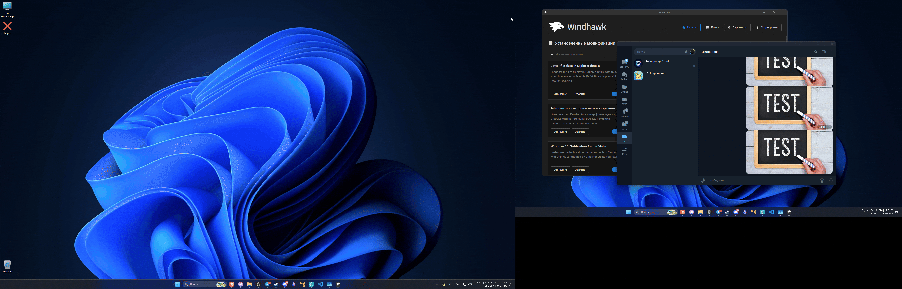

# Secondary windows on the active monitor

**English** | [Русский](README.ru.md)

Useful if you have **several monitors**. Many apps remember which monitor a secondary window (media viewer, player, dialog) was opened on and open it there again, even if you now work with the app on another monitor. For example, Telegram Desktop opens photos and videos on the monitor where the viewer was last time, not where the chat is. This [Windhawk](https://windhawk.net) mod opens secondary windows of the apps you choose on the monitor where the app's active window is.

## Features

- Works with any app: the list of apps is set in the mod settings (a placeholder `test.exe` by default - replace it with your app, for example `Telegram.exe`).
- Moves a secondary window to the active window's monitor before it is shown, so it doesn't flash on the old monitor.
- The window keeps its relative position (a window in a corner stays in the same corner of the other monitor); a window larger than the target monitor is shrunk to fit.
- A fullscreen window stays fullscreen; a maximized window stays maximized and, when restored, stays on the new monitor.
- Monitors with different scaling (for example 100% and 150%) are taken into account.
- App data and system files are not modified.

## Settings

| Setting | Default | What it does |
|---|---|---|
| Applications | `test.exe` | Apps whose secondary windows are moved. For each app: **Process** - executable name (`Telegram.exe` or `Telegram`) or full path; **Window title filter** - move only windows whose title contains this text (empty - all secondary windows) |
| Keep window position | on | On: the window keeps its place (a corner stays a corner). Off: the window is centered on the active window's monitor |
| Account for monitor scaling | on | Places the window so it fits after the app resizes it for a different scale (100% / 150%). Turn off if windows are placed wrongly on such a setup |

The mod is loaded into every process and unloads itself at once from those that are not in the list. An app added to the list starts to work after it is restarted; removing an app from the list applies immediately.

## Using it with other apps

Telegram Desktop is the only app the mod was tested with. For apps that are not built with Qt, the mod decides which windows are regular ones by a heuristic (it skips menus, tooltips, drop-down lists and tool windows), so it may move something it shouldn't, such as a drop-down list or a splash screen. If that happens, set a **Window title filter** for that app.

## Which windows are moved

**All** secondary windows of the app that get their own window and appear while the app is active: for Telegram also picture-in-picture video, call windows and chats opened in a separate window. Menus, tooltips, notifications and tool windows are not moved. If you keep some windows on another monitor on purpose, set a **Window title filter** for the app. Window titles often follow the app's interface language, so the filter works only for that language.

## Requirements

- Windows with two or more monitors.
- [Windhawk](https://windhawk.net).

## Installation

1. Install [Windhawk](https://windhawk.net).
2. In Windhawk click **Create a new mod**, replace the generated code with the contents of [`secondary-windows-on-active-monitor.wh.cpp`](secondary-windows-on-active-monitor.wh.cpp), then click **Compile Mod** and **Enable**.
3. In the mod settings add the apps you need to **Applications**.

The mod is being submitted to the official Windhawk catalog. Once it is accepted it can be installed directly: **Explore** -> search for **Secondary windows on the active monitor** -> **Install**.

## License

[MIT](../../LICENSE)
